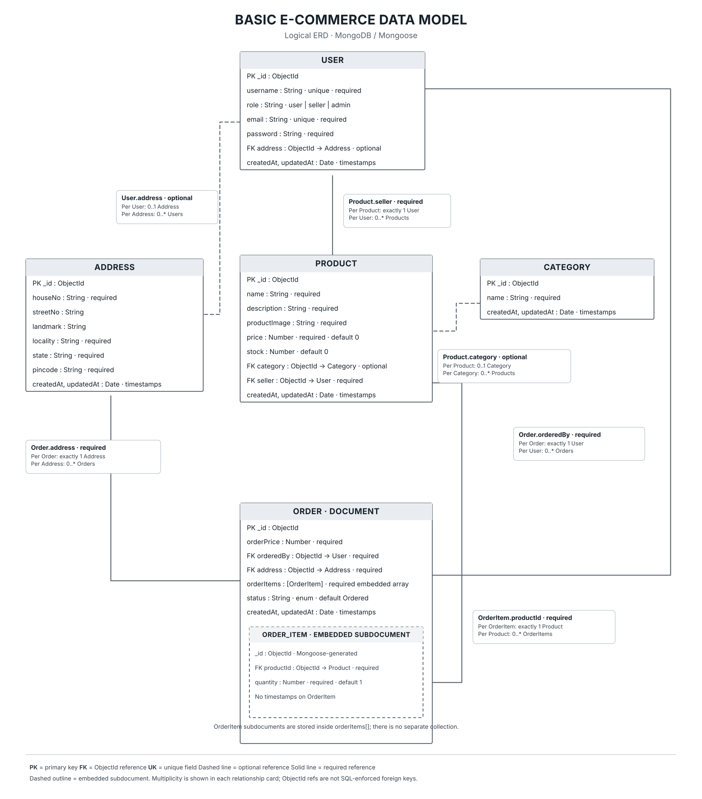

# Basic E-commerce Data Model

A simple guide for e-commerce data endpoints modelling using Mongoose.

## Entity Relationship Diagram

## Understanding the Relationships

| Relationship | Cardinality | Explanation |
|---|---|---|
| User – Address | Many-to-one, optional | A user can reference zero or one address. |
| User – Product | One-to-many, optional | A seller can have multiple products. |
| Category – Product | One-to-many, optional | A category can contain multiple products. |
| User – Order | One-to-many | Every order belongs to exactly one user. |
| Address – Order | One-to-many | Every order references exactly one address. |
| Order – OrderItem | One-to-many, embedded | An order contains an array of order items. |
| Product – OrderItem | One-to-many, optional | Each order item can reference a product. |